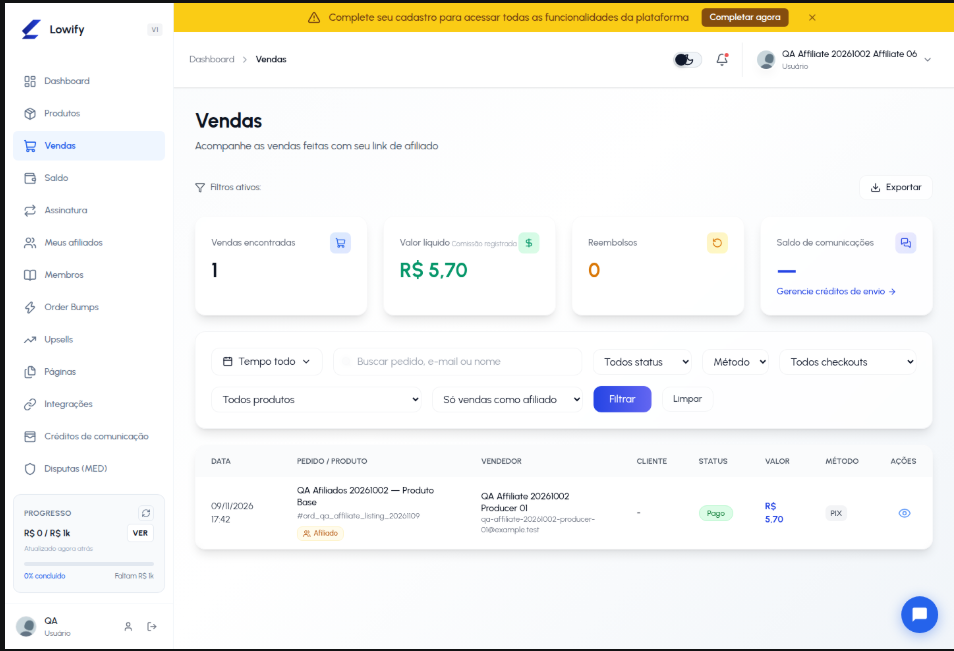

# Validação — vendas de afiliado na listagem

Ambiente: homologação. Esta validação investiga o relato de que uma venda de
afiliado não aparecia em **Vendas** para o seller afiliado. Não há deploy,
alteração de código ou mudança de dados de produção neste documento.

## Resultado consolidado

Não foi reproduzido defeito na listagem atual. A venda de QA aparece tanto em
**Tempo todo** quanto em **Só vendas como afiliado**.



## Cenário executado

| Item | Evidência |
| --- | --- |
| Afiliado de QA | Usuário de QA afiliado a produto de outro seller. |
| Venda controlada | `9794245593` / `ord_qa_affiliate_listing_20261109`. |
| Produto | `9900072` — QA Afiliados 20261002 — Produto Base. |
| Estado da venda | `paid`; comissão de afiliado em carteira. |
| Página | `dashboard-seller/sales.php`, com sessão real do afiliado. |

## Testes manuais

| Filtro da tela | Resultado |
| --- | --- |
| `Tempo todo` + todos os tipos | A venda apareceu. |
| `Tempo todo` + só como afiliado | A venda apareceu; é o cenário da captura. |
| `Tempo todo` + só como produtor | A venda não apareceu, como esperado: ela não é do produtor logado. |
| `Hoje` | A venda não apareceu, como esperado: a venda de QA não é do dia corrente. |

A captura foi revisada após a execução: mostra um resultado, o selo
**Afiliado**, o produto, o produtor e os filtros usados. Não contém código
Pix, token, dados de cartão ou dados de comprador.

## Conferência dos dados e da regra

Para o caso informado em produção, a consulta recebida retornou 22 vendas
associadas ao registro de afiliação `23`. Todas retornaram
`matches_sales_page_affiliate_filter = 1`; 21 estavam `paid`. Portanto, os
dados apresentados atendem à condição necessária para a listagem do afiliado.

Na tela, a regra atual é:

```text
todas:      venda do produtor logado OU venda cuja afiliação pertence ao logado
afiliado:   somente venda cuja afiliação pertence ao logado
produtor:   somente venda cujo produtor é o logado
```

Ela está em `dashboard-seller/sales.php`. Com `affiliate_sales_type=all`, a
consulta inclui `a.user_id_affiliated = usuário logado` quando a venda possui
`affiliate_id`; com `affiliate_sales_type=affiliate`, aplica a mesma relação
diretamente. Logo, não há uma exclusão de vendas de afiliado na regra atual.

## Limites e próximo dado necessário

Esta validação confirma o comportamento na revisão e no ambiente de
homologação atuais; ela não substitui uma reprodução no ambiente de produção.
No resultado de produção, as vendas eram Pix e Checkout Lowify e a mais
recente era de 10/11/2026. Elas não aparecerão se, no momento do relato, tiver
sido usado algum destes filtros:

- período `Hoje` em data posterior;
- `Só vendas como produtor`;
- método Cartão;
- Checkout Transparente.

Se o relato persistir com **Tempo todo**, **Todos os tipos de venda**, **Todos
os status**, **Método** vazio, **Todos os checkouts** e **Todos os produtos**,
registrar a URL completa ou uma captura que mostre todos os filtros ativos.
Esse é o dado mínimo para reproduzir o estado de produção sem inferir uma
causa inexistente.

## Conclusão

Validação aprovada para a regra atual: a venda afiliada controlada é exibida
para o afiliado. Não há correção a publicar com as evidências disponíveis.
