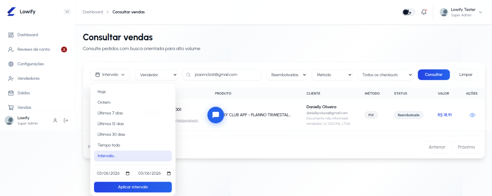

# Validação — vendas reembolsadas por seller

Ambiente: homologação. Esta validação investiga o relato de que vendas
reembolsadas não apareciam em **Consultar vendas** ao buscar o seller `586`.
Não há deploy, alteração de código ou mudança de dados de produção neste
documento.

## Resultado consolidado

Não foi reproduzido defeito na busca atual. Com **Intervalo** de
`2026-03-06` a `2026-03-06`, vendedor `joaomcbat@gmail.com`, status
**Reembolsadas**, método vazio e todos os checkouts, a venda controlada
apareceu.

## Cenário executado

| Item | Evidência |
| --- | --- |
| Seller | `586` — `joaomcbat@gmail.com`. |
| Venda controlada | `1274505` / `ord_8158ffa6a3aea001`. |
| Data da venda | `2026-03-06`. |
| Reembolso | Registro aprovado em `sales_refund`. |
| Página | `dashboard-seller/sales_consult.php`, em sessão administrativa real de homologação. |

## Testes manuais

| Filtro | Resultado |
| --- | --- |
| Tempo todo + Reembolsadas | A venda apareceu. |
| Intervalo de `2026-03-06` a `2026-03-06` | A venda apareceu; é o cenário da captura. |
| Intervalo em 11/11/2026 | A venda não apareceu, como esperado: esta é a data de registro do reembolso, não da venda. |

A captura foi revisada após o teste: ela mostra **Intervalo**, as duas datas,
o seller pesquisado, o status **Reembolsadas**, o selo **Reembolsado** e um
resultado. O navegador exibiu `03/06/2026`, mas o parâmetro aplicado foi o
ISO `2026-03-06`. Não contém código Pix, token ou dados de cartão.

## Conferência da regra

Em `SearchSalesUseCase`, o período é convertido em `date_start` e `date_end`.
Em `SaleRepository::applyAdminConsoleFilters`, esse intervalo é aplicado em
`sales.sale_timestamp`; o status **Reembolsadas** exige a existência de
`sales_refund` com `status = approved`. A busca por vendedor resolve o e-mail
para o usuário e aplica esse identificador em `sales.id_usuario`.

Portanto, o filtro de intervalo usa a **data original da venda**, não a data
em que o reembolso foi solicitado ou aprovado. A imagem do relato mostra
**Intervalo**, mas não mostra as duas datas escolhidas. Esse é o candidato
compatível com o relato, sem evidência suficiente para tratá-lo como causa
confirmada.

## Conclusão

Validação aprovada para a regra atual: uma venda reembolsada do seller `586`
é retornada pela listagem. Não há correção a publicar com as evidências
disponíveis. Para confirmar o relato histórico, é necessário obter o intervalo
exato usado na consulta e compará-lo com a data original da venda.
